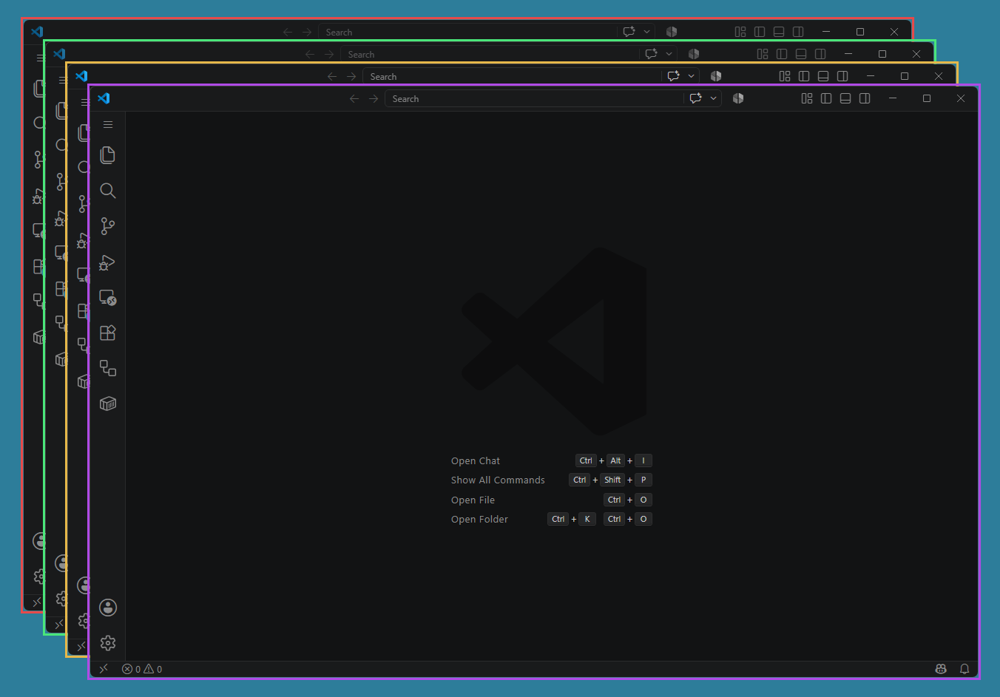
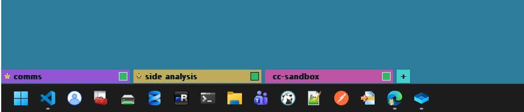
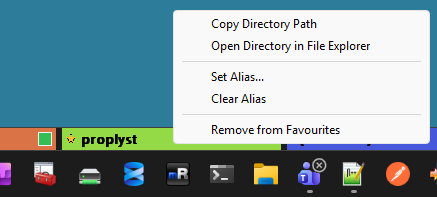
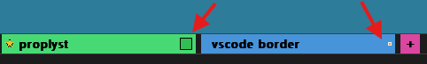
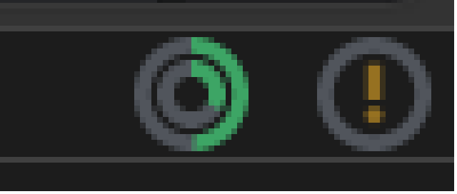
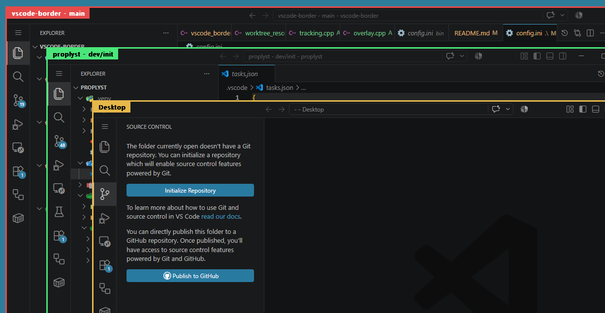

# vscode-border

Draws a colored border around every VS Code window so you can tell windows
apart at a glance. Each window gets its own color, assigned automatically.



## How it works

Each VS Code top-level window gets its own lightweight, click-through,
layered popup window painted as a hollow colored rectangle just outside the
target window's bounds. The overlay tracks its target's position, size,
Z-order, and visibility via `SetWinEventHook` (mainly
`EVENT_OBJECT_LOCATIONCHANGE`) -- no polling/redraw loop while idle. A slow
timer (`rescan_interval_ms` in `config.ini`) exists only as a safety net for
any missed event.

This means it works regardless of Windows theme/personalization settings,
and even when a window is maximized (the frame just gets clipped at whatever
screen edge the window is flush against).

For the non-obvious design decisions behind this (Z-order gotchas, why a
custom overlay instead of Windows' native border-color API, why there's
still a periodic rescan and what alternatives were considered), see
[docs/ARCHITECTURE.md](docs/ARCHITECTURE.md). For measured CPU/RAM/handle
numbers and the optimizations that came out of them, see
[docs/PERFORMANCE.md](docs/PERFORMANCE.md).

## Build

Requires the WinLibs MinGW-w64 g++ toolchain (installed via
`winget install BrechtSanders.WinLibs.POSIX.UCRT`).

```powershell
powershell -ExecutionPolicy Bypass -File build.ps1
```

Produces `bin\vscode_border.exe` (statically linked -- no MinGW runtime DLLs
needed) and copies the default `config.ini` into `bin\` if one isn't already
there.

## Run

```powershell
Start-Process bin\vscode_border.exe
```

It runs in the background with a tray icon (right-click for **Close All
Windows** / **Restart All Windows** / **Hide Borders and Hub** / **Reload
Config** / **Open Config** / **Open Log Folder** / **Capture Diagnostic
Snapshot** / **Exit**). **Close All Windows** asks for confirmation, then
closes every VS Code window (VS Code still prompts about unsaved changes).
**Restart All Windows** asks the same, then closes every window and, once VS
Code has exited, opens each folder again as the [Claude
profile](#claude-profiles) it was running -- a full VS Code restart, e.g. to
pick up a changed environment. A window that's still open a minute later
(its close was cancelled at the unsaved-changes prompt) is left as it is;
the confirmation lists any window whose folder isn't known, which closes
but can't come back.
**Hide Borders and Hub** is a checkable toggle that quickly hides
every border overlay and the project list HUD together; it isn't saved, so
the next launch shows everything again (to turn one off for good, use its
flag in `config.ini`, e.g. `show_project_list=false`). To launch it
automatically at login, see [docs/AUTOSTART.md](docs/AUTOSTART.md).

When a border is drawn wrong (often on a particular monitor setup) and you
don't have time to dig in, pick **Capture Diagnostic Snapshot** *before*
hiding the borders. About half a second later it saves
`bin\logs\snapshots\snapshot_<timestamp>\` and shows a balloon (click it to
open the folder). The folder holds a screenshot of the whole desktop in
physical pixels (`screen.png`), a `report.txt` with every monitor's
rect/work area/DPI scaling/display mode, the taskbars, this app's DPI
awareness, and, for each tracked window, its window/DWM-frame/overlay rects
both as the app sees them and physically, the border gap on each side, the
z-order, and border-color pixel samples read from the screenshot (with
anything covering the border called out). It also copies `config.ini` and
the current session's log. Snapshots aren't pruned with the logs.

If something unexpected happens during a run (e.g. a VS Code window's
title doesn't match any recognized shape -- see [Getting the repo/branch
label](#getting-the-repobranch-label-instead-of-just-the-folder-name)), the
tray icon gets a small yellow "!" badge and its tooltip changes to say
so. **Open Log Folder** jumps straight to the current session's log file
under `bin\logs\` (set `verbose_logging=true` in `config.ini` for full
per-event tracing on top of that). Every launch starts a new file rather
than overwriting the last one -- so closing the app (even by accident) never
loses whatever was already logged -- named
`vscode_border_<session-start-timestamp>_<part>.log`; a long-running
session gets a new part once a day (and, as a safety net, if a single part
grows past 5 MB) without losing the rest of that session's history, and
files sharing the same `<session-start-timestamp>` prefix are all part of
the same run, in `part` order. Files older than 14 days are deleted
automatically on the next startup. The warning badge only ever reflects
the current run -- restarting the app is what clears it (past runs' logs
are still there under `bin\logs\` to look at, they just don't affect the
badge).

## Configuration

Edit `bin\config.ini` (copied there from the template at the repo root on
first build):

| Key | Meaning |
|---|---|
| `thickness` | Border width in pixels, drawn just outside each window. |
| `opacity` | 0 (invisible) - 255 (fully opaque). |
| `rescan_interval_ms` | Safety-net rescan interval; new/closed windows are normally detected instantly. |
| `colors` | Comma-separated `RRGGBB` hex colors, assigned round-robin to windows. |
| `show_label` | Show the folder/repo name as a label chip inside the border's top-left corner (`true`/`false`). |
| `show_project_list` | Show an interactive project list HUD in a band reserved directly above the taskbar, using the same labels/colors as the border chips; includes minimized windows so it doubles as a restore list (`true`/`false` -- see below). |
| `project_list_fixed_match_taskbar` | Paint the hub's whole reserved band to look like the taskbar (`true`), or leave its empty part showing the desktop (`false`). Default `true`. |
| `project_list_opacity_normal` | Project list HUD opacity when no item is hovered: 0 (invisible) - 255 (fully opaque). |
| `project_list_opacity_hover` | Project list HUD opacity for the currently hovered item: 0 (invisible) - 255 (fully opaque). |
| `project_list_activate_on_hover` | Temporarily activate the matching VS Code window when hovering a project-list item (`true`/`false`, default `false`). |
| `label_height` | Label chip height in pixels. |
| `label_font_size` | Label text font size in points. |
| `label_text_color` | Label text color: a hex `RRGGBB` color, or `auto` to pick black/white based on contrast against the border color. Default `000000` (black). |
| `label_alias_format` | Border label text for a window with an alias (see [aliases](#project-list-hud-aliases)), using the tokens `<Alias>` and `<Branch>`, e.g. `<Alias> - <Branch>` (default) or just `<Alias>`. Outside a git repo a format using `<Branch>` shows just the alias. The project list HUD always shows just the alias. |
| `ai_indicator_enabled` | Show the AI status indicator on project list HUD items (`true`/`false` -- see below). Default `true`. |
| `ai_indicator_provider` | Comma-separated AI services to source it from: `claude` (implemented) and/or `copilot` (reserved, not yet implemented). |
| `ai_indicator_color_working` / `_attention` / `_waiting` | Hex `RRGGBB` colors for the 3 states -- see below. |
| `ai_indicator_border_color` | Indicator border color: `auto` (black/white by contrast) or a fixed hex `RRGGBB`. Default `auto`. |
| `usage_meter_enabled` | Show Claude usage rings at the right end of the project list HUD (`true`/`false` -- see [Claude usage rings](#claude-usage-rings)). Default `true`. |
| `usage_meter_refresh_minutes` | How often to re-read Claude usage, in minutes (1-60). Default `5`. |
| `claude_profile_<N>_name` / `_profile_path` / `_icon` / `_color` / `_ring_badge` | Claude profiles (see [Claude profiles](#claude-profiles) and `config.ini`): profile 1 is the default (`%USERPROFILE%\.claude` unless `_profile_path` says otherwise), 2-5 further Claude Code config folders, unused while `_profile_path` is empty. `_name` empty (default) shows the email the profile is signed in with. `_color` is the background of that profile's usage rings, hex `RRGGBB`; empty (default) leaves it transparent. `_ring_badge=false` hides the profile's icon in front of its usage rings (default shown). |

After editing, use the tray icon's **Reload Config** to apply changes
without restarting -- except for `colors`, which only takes effect on the
next launch (windows already tracked keep the color they were assigned).

## Project list HUD

An interactive strip of your open VS Code windows, docked directly above
the taskbar -- using the same labels and colors as the border chips, so you
can find and switch between windows at a glance. It includes minimized
windows, so it doubles as a restore list. Enable it with
`show_project_list=true`. A plain right-click on an item opens a context
menu (**Reopen As**, **Copy Directory Path** / **Open Directory in File
Explorer** for the window's folder, **Fit to Screen**, **Set Alias**, **Add to Favourites** and **Close Window**
-- see below).



### Project list HUD position

The HUD registers as a desktop toolbar
(an "AppBar", the same mechanism docked toolbars use) on the bottom edge of
the primary monitor. Windows reserves a band `label_height` pixels tall
directly above the taskbar for it and shrinks the desktop work area to
match, so maximized windows stop above the band instead of covering the
HUD. The band stays reserved while the app runs, even with no VS Code
windows open, so maximized windows don't jump each time one opens or
closes.

Inside the band, Ctrl+left-click-dragging either edge resizes the HUD,
and Ctrl+left-click-dragging the middle slides it sideways -- it just
can't leave the band. That placement is remembered per monitor scenario
(see below). The HUD hides while a fullscreen app (a game, a fullscreen
video) is up. Exiting the app, setting `show_project_list=false` or the
tray's **Hide Borders and Hub** releases the band.

With `project_list_fixed_match_taskbar=true` (the default), the rest of the
band is painted to look like the taskbar, so the band reads as an extension
of it instead of a strip of wallpaper. Rather than guessing from theme
settings, it copies what the taskbar actually shows on screen -- a thin row
of pixels just inside its top edge, one color per column -- so it follows
dark/light mode, accent color, transparency, Windows 10 vs. 11, and
taskbar restyling tools on its own. A solid taskbar gives a solid band; a
translucent one gives the blurred wallpaper's colors column by column. The
taskbar's own top edge (a 1px border line on Windows 11) is copied too, as
the band's top border -- the band is 1px taller for it, with the HUD
sitting below it the way the taskbar's icons sit below the taskbar's line. That
is a snapshot, not a live blur: it's refreshed every 30 seconds and shortly
after any theme, accent or wallpaper change (never while the mouse is over
the taskbar, so a hover highlight isn't copied). With an auto-hide taskbar
there's nothing to copy, so it falls back to plain dark or light, per the
Windows theme.

### Project list HUD ordering

Plain left-click-and-hold on an item (as
opposed to a plain click, which activates its window) drags it to a new
position: as you move it, the other items shift live to open a gap at the
candidate drop spot, and the item you're dragging floats above them,
following the cursor, so you can always tell exactly where it'll land
before you let go. Windows that appear for the first time are appended at
the end until you place them. The order is matched by label text (same
caveat as aliases: two windows sharing an identical label are kept
adjacent to each other, not independently ordered, and a `(no folder)`
window keeps its place only while it stays open). An item can be dropped
anywhere in the list, and a [favourite](#project-list-hud-favourites-and-recent-folders) is
ordered like any other item -- being one only adds its star, it doesn't
move it. The order lasts until the app exits and isn't saved -- no project
is reopened at startup, so there would be nothing for a saved order to
apply to.

### Project list HUD item context menu

Right-clicking a HUD item (or its border label chip -- both act on the same
window) opens a menu of everything you can do with that window's project,
grouped top to bottom: reopen, directory actions, alias actions,
favourites, close.



- **Reopen As** is a submenu of the other [Claude profiles](#claude-profiles)
  (every configured one but the window's own): picking one closes the
  window (VS Code still asks about unsaved changes) and, once it's gone,
  opens its folder again in a new window as that profile -- not before,
  since VS Code keeps one window per folder and would just bring the old
  one forward. If the window is still open a minute later (the close was
  cancelled), nothing is reopened. Not shown with no other profile
  configured.
- **Copy Directory Path** puts the window's open folder on the clipboard as
  plain text.
- **Open Directory in File Explorer** opens that folder in a new Explorer
  window. If the folder no longer exists (a worktree deleted while its
  window stayed open, say) nothing opens -- Explorer would otherwise
  silently show its Home view instead.
- **Fit to Screen** brings the window back onto its monitor when it has
  ended up bigger than the screen or partly off it (after plugging in or
  unplugging a monitor, say): it un-maximizes it, sizes it to 75% of the
  screen's width and height (not counting the taskbar) and centers it, on
  whichever monitor most of the window is on.
- **Set Alias...** / **Clear Alias** rename how the window displays -- see
  [aliases](#project-list-hud-aliases) below.
- **Add to Favourites** / **Remove from Favourites** save or drop that
  folder from the "+" button's favourites menu -- see
  [favourites](#project-list-hud-favourites-and-recent-folders) below.

The directory and favourites groups act on the folder the window actually
has open -- a worktree or a subdirectory of a repo, not the repo's root --
which is resolved to a real absolute path via the same workspaceStorage
lookup the AI status indicator and worktree name substitution use. When
several folders VS Code has opened share that folder's name (every repo's
`src`, say), the one inside the window's repo wins, then the one VS Code
used most recently. When VS Code
hasn't recorded a folder for that window (a multi-root workspace, for
instance), there's nothing for those items to act on, so both groups are
left off entirely rather than shown greyed out, leaving just the alias
group. **Clear Alias** likewise only appears once the item actually has an
alias.

### Project list HUD aliases

Right-click any item (or its border label chip -- same underlying label)
and choose **Set Alias** to rename how it displays, without touching the
actual folder/repo/branch. The item's text turns into an editable box in
place -- type the new name and press Enter (or click elsewhere) to save it,
or Escape to cancel; clearing the text back to empty removes the alias.
Once an item has an alias, the same menu also offers **Clear Alias**, which
removes it immediately without opening the edit box. The HUD item shows the
alias alone; the border label chip shows it per `label_alias_format`
(default `<Alias> - <Branch>`, so the branch stays visible). Aliases are matched by
the label's exact text, so if two windows ever happen to produce the
identical label, aliasing one aliases both. Stored in `label_aliases.ini`
next to `config.ini`, and re-read on **Reload Config** as well as at
startup.

The exception is a window with no folder open at all (shown as
`(no folder)`): every such window shares that label, so its alias belongs
to that one window instead. It lasts only while the window stays open and
is never saved to `label_aliases.ini`, since there's nothing to recognize
the window by after it closes or the app restarts. Opening a folder in that
window switches it over to the folder's own alias, if any.

### Project list HUD favourites and recent folders

Clicking the fixed "+" square at the end of the project list HUD opens a
menu. **Start VS Code** opens a brand-new, empty VS Code window -- with
[Claude profiles](#claude-profiles) configured besides the default it's a
submenu of which profile to open it as. Below it, past a divider, is
**Recent** (see below), then past another divider a
**Favourites** submenu: your saved favourite projects/folders
sorted by name, one submenu per favourite -- hover a favourite's name to expand it to
**Open in New Window As** (a submenu of the Claude profiles to open it as;
on an open folder it just brings its window forward, whatever profile that
runs), **Copy Directory Path** / **Open Directory in File Explorer** (as
on a HUD item), **Set Alias...** / **Clear Alias** (the same
[aliases](#project-list-hud-aliases) as on a HUD item, so a favourite can be
renamed without opening it -- the edit box appears just above the "+"
button) and **Remove from Favourites**.

To add a favourite, right-click any regular item (or its border label
chip) and choose **Add to Favourites** -- this saves the window's currently
open folder (resolved to a real absolute path, with the same caveats as the
rest of the [item context menu](#project-list-hud-item-context-menu) above).
Once that folder is a favourite, the same item's menu offers **Remove from
Favourites** in its place. That only reaches a favourite while its window is
open, though -- the "+" button's own menu is the way to remove one that
isn't. A favourite is the folder, matched by its path (not label text),
whatever [Claude profile](#claude-profiles) its window runs: the star shows
for it in any profile, and it stores no profile -- **Open in New Window As**
picks one each time. A favourite's alias is keyed by the label its window
showed when last seen open (for a git repo that includes the branch), so it
applies again as long as the folder opens to the same label. Favourites are
stored in `favourites.ini` next to `config.ini`. Favourites are never opened automatically.

The **Recent** submenu lists the last 10 folders VS Code
opened (stable and Insiders together), most recent first, whether they're
open right now or a favourite or not; folders that no longer exist are left
out. It comes from VS Code's own records (`workspaceStorage`), so it also
covers folders opened before the app was running. Each one has the same
submenu as a favourite, with **Add to Favourites** when it isn't one yet.
Its name and alias follow the same label a window with that folder open
would show -- for a git checkout, the repo and the branch it's on now.

### AI status indicator

Each HUD item can show a small status indicator in its top-right corner
for an AI coding assistant running in that VS Code window's terminal(s):



- **Working** -- amber, a small square chasing itself around an 8-position
  ring -- actively generating a response or running a tool (from
  `UserPromptSubmit` until the turn's `Stop`/`StopFailure`/`SubagentStop`).
- **Attention** -- red, a single pulsing square -- blocked mid-turn on a
  permission prompt or an MCP server asking the user something. This is
  the state that most needs you to look at it.
- **Waiting** -- green, a single static square -- the turn has finished
  and no background work is left, ready for your next prompt.
- No indicator at all if nothing's running there.

The indicator always follows what Claude Code itself tracks for the session
-- see [docs/ARCHITECTURE.md](docs/ARCHITECTURE.md#ai-status-follow-claude-code-background-work-included),
which also keeps the history of how that rule has changed and why.

Background work still running when a turn ends (a command running in the
background, whether Claude started it or you sent it there with Ctrl+B, or
a background subagent) keeps the indicator on **Working** until that work
ends, however it ends. That's the same work the Claude Code CLI lists in
its footer and `/tasks`; the VS Code extension's panel just doesn't show it.
Not counted: Claude Code's own live-update watchers and housekeeping tasks,
teammates, and pending `ScheduleWakeup`s / `/loop`s, since nothing is
running until one fires. A command left hung in the background keeps the
indicator on Working until you stop it. The background tasks listed at each
`Stop` are logged in `bin\logs\claude_hook_events.log`, each marked
`counted` or `ignored`.

**Attention** can go stale on its own: there's no "permission granted, resuming" hook (unlike MCP
elicitation, which has `ElicitationResult`), so once a permission prompt
fires, nothing updates the status again until the turn's eventual `Stop` --
even if you answered it seconds later and Claude went right back to work.
Rather than guess with a timeout (any guess is wrong either for a prompt
you haven't actually answered yet, or for one you have), `claude_provider.cpp`
cross-checks against real evidence: Claude Code writes a transcript file per
session under `~/.claude/projects/<encoded-cwd>/<session_id>.jsonl`, gaining
a new line for every message and tool call regardless of which hooks are
wired up. If that file has been written to more than 10 seconds after the
status file's last hook-reported snapshot, that's independent proof
something happened more recently than what the hooks told us -- so the
status is corrected to "Working" instead of staying on a stale "Attention"
(or "Waiting"). Confirmed against a real stuck case: a `PermissionRequest`
fired and froze the status on "Attention" while the transcript kept growing
for another 14 minutes until the turn's `Stop` finally arrived -- this check
catches exactly that gap. Degrades harmlessly if the transcript file can't
be found (e.g. a future Claude Code version changes this layout) -- the
status just stays as last reported by the hooks, same as before this
existed.

That activity check turned out to be too loose in one direction and too
short-lived in the other, so a permission prompt now uses something exact
instead. The `PermissionRequest` hook records which tool call is blocked
(`pending_tool=<tool_use_id>`). The payload doesn't say -- the hook docs show a
`tool_use_id` on `PermissionRequest`, but Claude Code 2.1.270 doesn't send one
(confirmed from a captured real payload and from its bundled source) -- so the
hook finds it in the transcript, where the call's `tool_use` block is already
written: the unanswered call with that `tool_name` whose input equals the
payload's `tool_input`, or failing that the first unanswered one in the newest
assistant message. The hook log line says which (`toolUseId=... (via
exact-input)`), or `(unresolved)` if neither found it, in which case the looser
activity check below still applies. The answer to that prompt always lands in
the transcript as that same call's `tool_result` -- the approved tool's
output, your `AskUserQuestion` answers, or the rejection. Checked across 131
real transcripts: every one of 15,043 occurrences of `"tool_use_id":"<id>"`
was that call's own result. So "Attention" clears the moment that line
appears, with no timing window to expire (a session that answers a prompt and
then writes one long response can go ten minutes without touching its
transcript, which the 30-second activity window read as "back to
Attention"), and unrelated writes while the prompt is still open -- a
parallel tool's result, a title update -- no longer clear it early. A
subagent's prompt is watched in the subagent's own transcript
(`<session>/subagents/agent-<id>.jsonl`), where its result is written.

The hook also records Claude Code's own `transcript_path` for every event
rather than leaving the app to derive it from `cwd`. `cwd` follows the
session's shell, so once Claude `cd`s into a subfolder the derived path
names a transcript directory that doesn't exist -- which is how a session
sat on a pulsing "Attention" for over half an hour after its question had
been answered: its status file said `cwd=...\proplyst\src\web\app\src`, and
every transcript check silently found nothing.

**Working** has the opposite gap: `Stop` does not fire when the user
manually interrupts a turn (Escape/Ctrl+C mid-response), confirmed against
a real session that stayed reported as "Working" for over 20 minutes after
being interrupted, with no hook ever firing again. Rather than another
timeout, this uses an even more direct piece of evidence: Claude Code
appends a literal `[Request interrupted by user]` marker to the transcript
the moment an interrupt happens. If a session's status is "Working" and the
transcript's last message is that exact marker (meaning nothing has
happened since), it's corrected to "Waiting" -- an interrupted turn is over,
same as a normal one. Lines that aren't messages are skipped, since
renaming the session after the interrupt appends title lines after the
marker.

The transcript directory name is derived from the project's absolute path:
every non-alphanumeric character (`:`, `\`, `.`, a space, an already-literal
`-`, etc.) becomes its own `-`, not collapsed -- confirmed against real
directories on disk, including a worktree path with a literal `.` in it
(`...\repo.worktrees\...` became `...-repo-worktrees-...`, the `.` isn't
special-cased).

If a window has more than one session running (e.g. several terminals),
the indicator reflects the aggregate, in that priority order: Attention
beats Working beats Waiting.

Controlled by `config.ini`:

```ini
ai_indicator_enabled=true      ; turn the whole feature on/off
ai_indicator_provider=claude   ; comma-separated: "claude" today, "copilot" reserved for later
ai_indicator_color_working=FF9F0A
ai_indicator_color_attention=DC2626
ai_indicator_color_waiting=34C759
ai_indicator_border_color=auto ; "auto" (black/white by contrast) or a fixed hex RRGGBB
```

Claude Code has no built-in way for another app to observe its state, so
this works via Claude Code's **hooks**: `claude_status_hook.ps1` (repo
root, copied to `bin\` on every build) runs on several of Claude Code's
lifecycle events and writes a small status file per session under
`bin\claude_status\`. This app manages the hook registrations in every
[Claude profile](#claude-profiles)'s `settings.json` (the default one is
`%USERPROFILE%\.claude\settings.json`) for you -- automatically, on
startup and every **Reload Config** -- adding them when
`ai_indicator_enabled=true` and `claude` is in `ai_indicator_provider`,
removing them otherwise. No manual JSON editing needed. It only ever
touches its own entries (recognised by the hook script's name, so a
relocated install's old ones are found and replaced too) -- everything else
in that file, including hooks you've
added yourself, is left alone. If it can't safely parse that file (e.g. a
hand-edit broke its JSON), it logs a warning, sets the tray icon's warning
badge, and leaves the file untouched rather than risk overwriting it -- see
`src/claude_provider.*` and `src/json_scan.*`.

This is Claude Code's implementation of a generic `AiProvider` interface
(`src/ai_provider.h`) -- installing/removing whatever config it needs and
reading back whatever it reported are the two things any AI assistant
integration has to do, so a future Copilot integration would plug in the
same way, behind the same interface, without changing anything else that
uses it (`tracking.cpp`'s window-matching).

A hook here applies to every Claude Code session on the machine, in any
project -- not just this repo. Changes to a profile's `settings.json` are
picked up by already-running sessions automatically (typically within a
few seconds), so nothing needs restarting for it to take effect. Each
status file is matched to a tracked window by folder (a real absolute-path
match when VS Code has recorded one, e.g. via `workspaceStorage`, falling
back to a plain name comparison otherwise -- see `src/claude_provider.*`
and `src/worktree_resolver.*`). A window with no folder open (`(no folder)`)
takes the sessions whose cwd is exactly your home directory, which is where
Claude Code starts in such a window. If several no-folder windows are open
they all show the same status, because nothing in a session says which of them
it runs in. Stale/abandoned status files are cleaned
up automatically -- see "Known limitations" below for exactly how.

Every [Claude profile](#claude-profiles) gets the hooks, in its own
`settings.json`, all running the one script in `bin\`, so every profile's
sessions report to the same `claude_status\` folder (each status file notes
its profile's folder as `config_dir=`). Sessions match windows by folder
alone, whatever profile they run as: VS Code keeps one window per folder.
Turning the indicator off removes the hooks from every profile, and so does
dropping a profile from `config.ini` (the settings files hooks were put in
are listed in `bin\claude_hooks_installed.ini`). Hook entries this app wrote
from anywhere else -- an older install location, or a profile folder copied
from another Windows account -- are recognised by their script name and
replaced.

### Claude profiles

Claude Code keeps its login, settings, hooks and sessions in a config
folder: `%USERPROFILE%\.claude`, or whatever `CLAUDE_CONFIG_DIR` names. Each
such folder is a *Claude profile*, and VS Code windows can run different
ones side by side -- for example a personal and a work Claude login, from
the one Windows account. List them in `config.ini`'s `claude_profile_<N>_*`
settings: profile 1 is the default (the folder Claude Code uses with no
`CLAUDE_CONFIG_DIR`, unless its `_profile_path` names another), 2-5 are
further folders:

```ini
claude_profile_2_profile_path=%USERPROFILE%\.claude-work
```

- **Name:** `_name`, or when that's empty the email the profile is signed
  in to Claude with (`oauthAccount.emailAddress` in its `.claude.json`),
  else its folder's name.
- **Opening a window as a profile** -- the "+" button's **Start VS Code**,
  a favourite's **Open in New Window As**, an item's **Reopen As** -- runs
  the VS Code CLI with `CLAUDE_CONFIG_DIR` set to the profile's folder --
  the default profile's too -- the same as
  `$env:CLAUDE_CONFIG_DIR = "..."; code -n <folder>` in a terminal. VS Code
  hands the CLI's environment to the window it opens, and Claude Code in
  that window uses the profile.
- **Which profile a window runs** is read from the lock files Claude Code's
  VS Code extension writes into each profile folder's `ide\` when it starts
  in a window (VS Code's pid and the window's folders; the newest lock for a
  folder counts, while that VS Code runs), whoever opened the window -- the
  app, or `code` from a terminal. A window the app opened counts as the
  profile it was opened as until a newer lock says otherwise.
  A window with no folder open is told apart only when every such window
  runs the same profile.
- **Icon:** every window shows its profile's icon in front of its label,
  on the border's label chip and its hub item -- `_icon`, or a round badge
  with the name's first letter. The default profile's windows show one only
  when `claude_profile_1_icon` is set.
- **AI status and usage:** every profile gets the [AI status
  indicator](#ai-status-indicator) hooks and its own [usage
  rings](#claude-usage-rings).

Why the default profile gets `CLAUDE_CONFIG_DIR` too: VS Code lays each
window's CLI environment over the environment VS Code itself was started
with, so a variable that's simply left out can't undo an inherited one. If
VS Code was first started as another profile, a window opened "without" the
variable would still run that profile.

That has one consequence for the default profile. Without `CLAUDE_CONFIG_DIR`,
Claude Code keeps its state (`.claude.json`: projects, settings, the
signed-in account) in `%USERPROFILE%\.claude.json`; with it set -- even to
`%USERPROFILE%\.claude` -- it uses `.claude.json` inside the folder and
starts afresh if there's none. So once, before using the app this way:

1. Copy `%USERPROFILE%\.claude.json` to `%USERPROFILE%\.claude\.claude.json`.
2. Set `CLAUDE_CONFIG_DIR=%USERPROFILE%\.claude` as a user environment
   variable, so Claude Code run from a terminal, or a VS Code window opened
   from the Start menu, uses the same file.

The app warns (and badges its tray icon) while the default profile still
has only the `%USERPROFILE%` file.

### Claude usage rings

At the right end of the hub's band, above the system tray, each
[Claude profile](#claude-profiles) gets a pair of rings showing its Claude
usage limits, the same numbers as Claude Code's `/usage`: the outer ring is
the weekly limit, the inner ring the session (5-hour) limit. The default
profile (profile 1) comes first, then the others in slot order, each with
its icon in front -- the same icon its windows' items carry, so the default
profile's rings have one only when `claude_profile_1_icon` is set.
`claude_profile_<N>_ring_badge=false` hides it on the rings alone.



- **Colors:** green, amber from 70%, red from 90%. Grey while the first
  read is still on its way.
- **Unavailable:** whenever a profile's usage can't be read -- any
  failure: its login expired or is missing, the network or the API failed,
  the answer was unexpected -- its rings are replaced by a grey ring around
  a pulsing amber "!", so an empty ring is never mistaken for 0%. Hover to
  see why.
- **Background:** a profile's rings can sit on a chip of its own color, so
  the profiles are easy to tell apart: its `claude_profile_<N>_color` (hex
  `RRGGBB`). Without one there's no chip; the rings sit straight on the
  band.
- **Hover** for the profile's name, the exact percentages, when each limit
  resets, when the numbers were read, and why the last update failed, if it
  did.

The numbers come from `https://api.anthropic.com/api/oauth/usage`, called
with the profile's own Claude Code login token (`.credentials.json` in its
config folder), every `usage_meter_refresh_minutes`. That endpoint isn't a
documented API, so its format can change; when it does, the rings go grey
and the log says why. The app never refreshes the token itself: that would
rotate the refresh token Claude Code holds and sign Claude Code out. When it
has expired (no Claude Code session has run as that profile for about 8
hours), the app has Claude Code renew it: it runs Claude Code as that
profile (`CLAUDE_CONFIG_DIR` set to its folder) as `claude -p` with no
input, which renews the login and stops before calling the model, so it
costs no usage. It tries once per expired token and logs the result; if it
can't (no Claude Code found), the rings show the "!" until Claude Code next
runs as that profile, and the app reads usage again within seconds of that.

Every failure is logged as a `[WARN]` (once per distinct error, so the
same failure every few minutes doesn't flood the log), which also badges
the tray icon. A recovery is logged too. The design decisions behind all
this, and the options that were tried and dropped, are in
[docs/USAGE-RINGS.md](docs/USAGE-RINGS.md).

### Project list HUD position/size memory

Ctrl+left-click-dragging the project list HUD to slide or resize it is
remembered separately per **monitor scenario** -- the current set of active
monitors, identified by hardware id (so unplugging/replugging or switching
a projector between "extend" and "second screen only" doesn't lose the
placement you set for each one). Sliding it while on a laptop's built-in
screen, then again after connecting an external monitor, remembers both
independently and switches between them automatically as monitors are
connected/disconnected -- no manual re-positioning needed each time. A
scenario that's never been manually placed falls back to the default:
the right end of the band, sized to fit the labels. Stored in
`project_list_hud_positions.ini` next to `config.ini`.

### Getting the repo/branch label instead of just the folder name



The label is scraped from the VS Code window's title -- there's no other
way for an external app to ask VS Code what folder a window has open. By
default VS Code's title only contains the folder name, so to show the git
repo + branch instead, VS Code's `window.title` setting needs to be:

```json
"window.title": "${activeRepositoryName} - ${activeRepositoryBranchName} - ${folderName} - ${appName}"
```

**This is applied automatically -- no manual settings.json editing
needed.** Whenever `show_label=true` (the default), this app writes that
`window.title` value into VS Code's global `settings.json` for you (both
stable and Insiders, whichever are installed), the moment it starts or
Reload Config runs. If `window.title` already had some other value, the
original is remembered (in `window_title_state.ini` next to `config.ini`)
and restored automatically the next time you set `show_label=false` and
reload. If `window.title` wasn't set at all, it's removed again on
disable, leaving the file exactly as it was found.

If `window.title` already happened to have exactly that same value before
this app ever touched it (e.g. you'd set it manually per an older version
of this doc), it's left alone and not tracked for restoration -- turning
the label off later won't remove it. If you edit `window.title` yourself
while the label is on, that edit is respected: this app notices the value
no longer matches what it wrote and stops managing it rather than
overwriting your change.

With this set, the label shows `repo - branch` when the window is inside a
git repo, and falls back to just the folder name otherwise (e.g. a plain
folder with no `.git`, or an empty window). If you use git worktrees, VS
Code's `${activeRepositoryName}` shows the *worktree's* folder name rather
than the main repo's -- this app corrects that automatically as long as
your worktrees follow the `<mainRepo>.worktrees\<worktreeName>` layout, by
reading VS Code's own recently-opened-folder records. That mapping is
built once and cached in memory; use **Reload Config** from the tray icon
to pick up worktrees created after the app started.

## Known limitations

- Only tracks VS Code's own top-level windows (`Code.exe` / `Code -
  Insiders.exe` main editor windows, not floating panels/dialogs).
- If you have more open windows than colors in the palette, colors repeat.
- Border thickness/color is drawn by this app, not by Windows -- closing the
  app removes all borders immediately (nothing persists in the registry or
  window state).
- Deleting/uninstalling this app while `show_label=true` leaves the
  `window.title` edit it made in VS Code's `settings.json` in place --
  there's no uninstall hook to restore it. Set `show_label=false` and let
  it reload (or start it once more) before removing the app if you want
  that reverted first.
- If a terminal running Claude Code is killed abruptly (not a clean `/exit`
  or closing the terminal normally), its `SessionEnd` hook never fires --
  Claude Code's hook payload has no process id or other liveness signal in
  it at all, so there's no *documented* way to detect that. This app works
  around it anyway: `claude_status_hook.ps1` walks up its own process
  ancestry looking for the real `claude.exe` process and records that pid,
  and `claude_provider.cpp` does a live lookup of that pid (via
  `OpenProcess`/`QueryFullProcessImageNameW`, confirming it's *still*
  claude.exe and not some unrelated process Windows has since reused that
  pid for) every time it reads statuses -- a confirmed-dead session is
  deleted automatically, no manual cleanup needed in the normal case. This
  relies on undocumented internals (specifically, that Claude Code's hook
  processes are descended from the main `claude.exe` process a small,
  bounded number of hops up) that could change in a future Claude Code
  update. The walk has two backstops, since in practice it fails only on
  `SessionStart` -- where an intermediate shell has already exited, leaving
  no chain to follow, and where there is also no earlier pid on file. A
  resumed session carries its own id on `claude.exe`'s command line
  (`--resume=<session_id>`), which identifies the process unambiguously, so
  that is tried next; failing that, any pid already recorded for the
  session is carried forward rather than dropped. Neither helps a *fresh*
  session that dies immediately, and whichever way the lookup ends it
  records why in `bin\logs\claude_hook_events.log` (`pidLookup=[...]`).
  If it does come up empty, that session's status is logged (`claude_provider: ... has no pid recorded`)
  and falls back to a much coarser, generous 24-hour staleness check
  instead (a status with no pid that hasn't been updated in over a day is
  treated as abandoned) -- deliberately not applied to the normal, precise
  pid-based path, since a genuinely long-running task can legitimately stay
  "working" for 30+ minutes and a short timeout would misfire on it there.
  Between the two, every case resolves on its own -- there's no manual
  clear/recovery action, by design, since one shouldn't be needed.
- Claude Code status matching falls back to a plain folder-name comparison
  when VS Code hasn't recorded that folder's real path (e.g. multi-root
  workspaces aren't covered) -- two windows opened on different folders
  that happen to share the same name are indistinguishable in that case.
- Deleting/uninstalling this app while `ai_indicator_enabled=true` leaves
  the hook entries it added in each profile's `settings.json` in place -- same
  caveat as `window.title` above, no uninstall hook runs. Claude Code will
  keep harmlessly invoking a now-missing script path. Set
  `ai_indicator_enabled=false` and let it reload (or start it once more)
  before removing the app if you want those removed first.

## Project layout

- `src/vscode_border.cpp` -- tray icon and app lifecycle (`wWinMain`).
- `src/file_util.*` -- shared exe-relative path / file-read / file-write helpers.
- `src/text_util.*` -- shared UTF-8-safe line-escaping helpers for the small `*.ini` state files below.
- `src/monitor_scenario.*` -- identifies the current active-monitor set and persists/recalls the
  project list HUD's placement per scenario (see "Project list HUD position/size memory" above).
- `src/label_alias.*` -- persists/recalls user-set label aliases (see "Project list HUD aliases" above).
- `src/favourites.*` -- persists/recalls the "+" button's favourite projects list (see "Project list HUD
  favourites" above).
- `src/ai_provider.h` -- abstract interface an AI coding assistant integration implements (install/remove its
  config, read back its reported status, manual clear) -- see "AI status indicator" above.
- `src/claude_provider.*` -- Claude Code's `AiProvider` implementation: installs/removes its hook
  registrations in every Claude profile's `settings.json`, reads the per-session status files
  `claude_status_hook.ps1` writes, and auto-expires ones whose recorded pid is no longer a live
  `claude.exe` process (see "Known limitations" above).
- `src/claude_profile.*` -- Claude profiles (Claude Code config folders): names, icons, the environment a
  window is opened with, and which profile a window runs (see "Claude profiles" above).
- `src/claude_usage.*` -- Claude session/weekly usage per Claude profile for the hub's usage rings: fetching,
  renewing an expired login, and the tooltip text (see "Claude usage rings" above).
- `src/json_scan.*` -- minimal JSONC span-scanner (find/insert/remove one key or array element without
  parsing/reserializing the rest of the file), generalized from `vscode_settings.cpp`'s scanner.
- `src/logger.*` -- file logging.
- `src/config.*` -- `config.ini` loading.
- `src/window_title.*` -- VS Code window title parsing (repo/branch/folder).
- `src/worktree_resolver.*` -- maps a git worktree's folder name back to its main repo name, and resolves a
  folder's real absolute path (used for the AI status indicator's window matching).
- `src/vscode_settings.*` -- auto-manages VS Code's `window.title` setting to match `show_label` (see [Getting the repo/branch label](#getting-the-repobranch-label-instead-of-just-the-folder-name)).
- `src/window_discovery.*` -- finding/filtering VS Code top-level windows.
- `src/overlay.*` -- passive per-window border overlay creation/painting.
- `src/project_list_hud.*` -- interactive desktop project-list HUD: sorts/sizes/positions itself from the entries it's given, plus hover focus, click, move, and resize behavior.
- `src/layered_rendering.*` -- shared alpha-blended text helpers for layered windows.
- `src/tray_icon.*` -- tray icon warning-badge compositing.
- `src/diagnostic_snapshot.*` -- tray menu's Capture Diagnostic Snapshot (screenshot + monitor/DPI/geometry report).
- `src/vscode_cli.*` -- locates VS Code's `code`/`code-insiders` CLI shim; opens new VS Code windows and closes all of them (shared by the hub and the tray menu).
- `src/vscode_installs.*` -- remembers VS Code's install from its windows (`vscode_installs.ini`), so a new
  window can be opened once none is open, without configuration.
- `src/tracking.*` -- tracked-window bookkeeping, WinEvent hooks, border sync, and feeding the HUD its entries.
- `src/resource.rc`, `assets/app.ico`, `assets/square-dashed.png` -- tray icon resource (`app.ico` is generated from the PNG; see [Credits](#credits)).
- `config.ini` -- default config template (copied to `bin\` on first build).
- `claude_status_hook.ps1` -- Claude Code hook script (copied to `bin\` on every build; see "Claude Code
  status dots" above).
- `build.ps1` -- build script.
- `install-autostart.ps1` / `uninstall-autostart.ps1` -- autostart management, see [docs/AUTOSTART.md](docs/AUTOSTART.md).
- [docs/ARCHITECTURE.md](docs/ARCHITECTURE.md) -- design decisions and why.
- [docs/PERFORMANCE.md](docs/PERFORMANCE.md) -- measured resource usage and optimizations.
- [docs/INVESTIGATING-WARNINGS.md](docs/INVESTIGATING-WARNINGS.md) -- how to chase down a `[WARN]` line in `bin\logs\`.
- [docs/USAGE-RINGS.md](docs/USAGE-RINGS.md) -- the Claude usage rings' design decisions, with the archived
  mockup [docs/usage-rings-mockup.html](docs/usage-rings-mockup.html).

## Credits

Tray icon: ["Square dashed" icon](https://www.flaticon.com/free-icon/square-dashed_17295663) from Flaticon.
